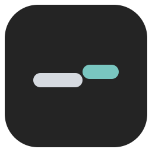
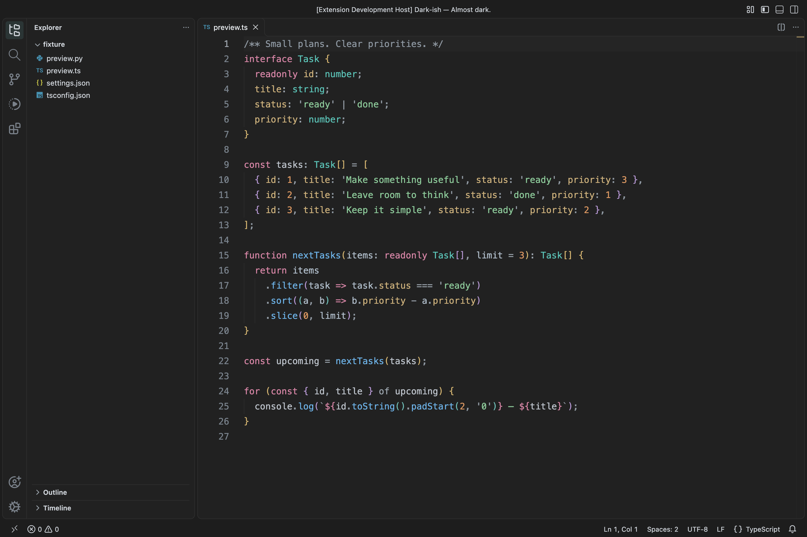
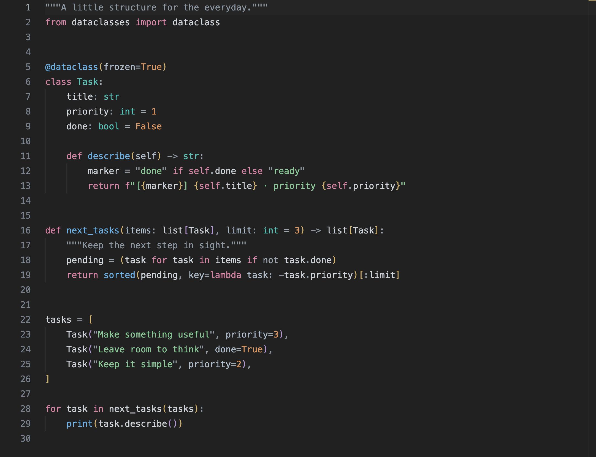
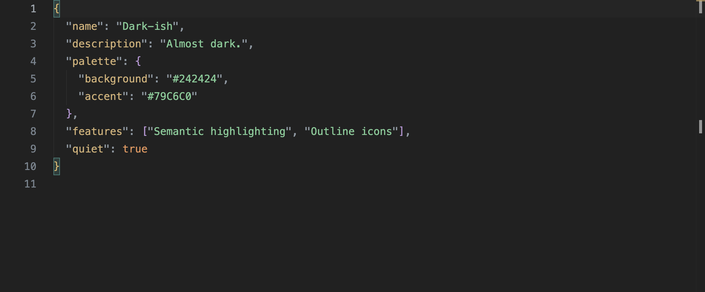

<p align="center">
  
</p>

<h1 align="center">Dark-ish</h1>

<p align="center">Almost dark.</p>
<p align="center">A graphite-gray VS Code theme with soft syntax colors and a touch of teal.</p>



## Installation

With a `dark-ish-theme-*.vsix` package:

1. Open the Extensions view in VS Code.
2. Click the `…` menu and choose **Install from VSIX…**.
3. Select the package.

Or install from the command line, using the filename for your version:

```sh
code --install-extension dark-ish-theme-1.0.0.vsix
```

## Choose your theme

Open the Command Palette (`Cmd+Shift+P` on macOS, `Ctrl+Shift+P` on Windows and Linux):

- Run **Preferences: Color Theme** and select **Dark-ish**.
- Run **Preferences: Product Icon Theme** and select **Dark-ish Outline**.

The color theme and product icons work independently. Outline icons style the Activity Bar and editor controls; use your favorite file icon extension alongside them.

## Features

- **A quiet graphite workspace.** The sidebar, editor, and panels share one background, with a slightly darker window frame.
- **Soft, distinct syntax colors.** Teal, blue, pink, and warm gold give types, functions, keywords, and properties their own place.
- **Semantic highlighting.** Semantic token colors and TextMate rules support different language extensions.
- **Matching outline icons.** Dark-ish Outline brings a lighter touch to navigation and editor controls.

## Code previews

### Python



### JSON



Screenshots show the current theme running in VS Code. Fonts, file icons, and semantic highlighting may vary with your settings and language extensions.

## Development

Clone the repository, open it in VS Code, and press `F5` to launch an Extension Development Host. Select **Dark-ish** in the new window.

Validate colors and resource references with no additional Python dependencies:

```sh
python3 scripts/validate-theme.py
```

Build an installable extension package:

```sh
npx @vscode/vsce package --no-dependencies
```
